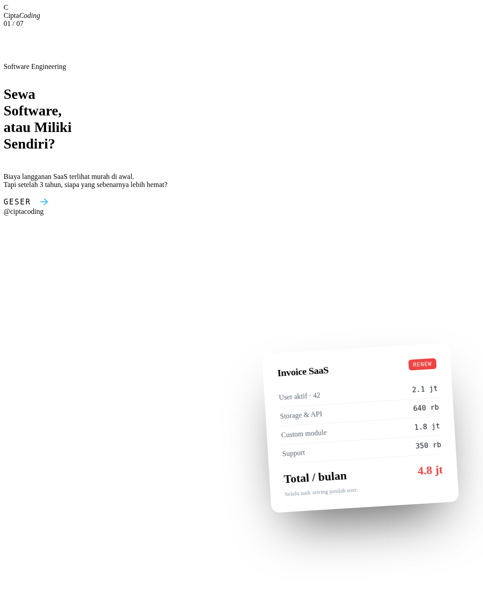

# CiptaCoding · Instagram Design System

Template carousel Instagram untuk **CiptaCoding** — software house & digital studio di Malang.
Dibangun dengan HTML/CSS murni, di-render jadi PNG 1080×1350 siap posting lewat Chrome headless.



---

## Kenapa repo ini ada

Konten Instagram CiptaCoding perlu konsisten, bukan sekadar "asik-asikan bikin design".
Repo ini menyimpan:

1. **Design tokens** — warna, tipografi, spacing, komponen (`src/assets/style.css`)
2. **Template slide** — file HTML per-slide, editable tanpa alat desain
3. **Pipeline render** — `render.py` mengubah HTML jadi PNG siap upload
4. **Arsip konten** — post yang sudah selesai, jadi referensi tim

Hasilnya: tim tinggal edit teks di HTML → jalankan satu perintah → PNG muncul di `exports/`.

---

## Quick Start

Butuh **Chrome/Chromium** dan **Python 3** (Pillow untuk verifikasi dimensi).

```bash
# Render semua slide di posts/
python3 render.py

# Render satu post saja
python3 render.py p1-custom-vs-saas
```

Output ada di `exports/<nama-slide>.png`, ukuran 1080×1350, siap upload (3:4 portrait).

> Font sudah di-inline base64 di `style.css`, jadi render tetap jalan tanpa koneksi internet.

---

## Brand tokens

Diambil langsung dari `ciptacoding.com` supaya nyambung dengan website.

| Token | Hex | Pemakaian |
|---|---|---|
| `--navy` | `#071850` | Background slide gelap, teks heading |
| `--blue` | `#0664fe` | Aksen utama, CTA, link |
| `--blue-deep` | `#0052d9` | Hover, border |
| `--sky` | `#38bdf8` | Aksen di atas background gelap |
| `--surface` | `#f4f8fe` | Kartu, panel |
| `--line` | `#e3ebf7` | Border hairline |
| `--ink` | `#111827` | Teks utama |
| `--ink-dim` | `#5b6675` | Teks sekunder |
| `--ink-weak` | `#8b95a5` | Meta, caption |

**Tipografi**
- `Plus Jakarta Sans` — 400 / 500 / 600 / 700 / 800 (UI + heading)
- `JetBrains Mono` — untuk label, nomor slide, meta, kode

**Kanvas** — 1080 × 1350 px, padding 88 px, radius 20 px.

---

## Aturan desain

- **Satu aksen per layar.** Tidak ada gradient ungu-biru-hijau. Tidak ada glow.
- **Hierarki lewat ukuran teks**, bukan kotak warna-warni.
- **Border hairline** menggantikan shadow. Shadow hanya untuk elemen yang benar-benar melayang.
- **Gelap–terang bergantian** antar slide supaya carousel tidak monoton.
- **Grid 72 px** dengan opacity sangat rendah sebagai tekstur, bukan hiasan.
- **Ikon = SVG inline**, bukan emoji. Emoji hanya untuk konteks informal yang memang sengaja.
- **Kontras minimum AA**: teks di atas navy pakai putih / `rgba(255,255,255,.72)`, tidak lebih pudar.
- Footer selalu ada: `@ciptacoding` + dot indicator (slide aktif = pill biru).

---

## Struktur slide carousel (7 halaman)

| # | Peran | Isi |
|---|---|---|
| 01 | Cover | Hook kuat + visual pendukung (mockup/invoice/UI) |
| 02 | Masalah / trade-off | Dua sisi, buat pembaca merasa relevan |
| 03 | Daftar tanda | 3–5 poin, masing-masing satu kalimat |
| 04 | Data / visual | Grafik atau angka yang membuktikan poin |
| 05 | Framework | Pertanyaan atau langkah untuk ambil keputusan |
| 06 | Kapabilitas | Proses kerja / layanan (soft-selling) |
| 07 | CTA | Ajakan + kontak + quick proof |

Pola ini bisa dipakai ulang untuk semua topik: ganti teks, sesuaikan visual di slide 01 & 04.

---

## Menulis konten

Nada bicara: **tech partner yang jujur**, bukan sales yang berlebihan.

- Mulai dari masalah nyata pemilik bisnis, bukan fitur.
- Pakai angka; hindari klaim kosong seperti "terbaik" atau "no.1".
- Kalimat pendek. Satu ide per baris.
- Tutup dengan CTA yang spesifik: konsultasi gratis, bukan "hubungi kami".

**Caption** disimpan terpisah di `posts/<nama>.caption.txt` — hook di 125 karakter pertama, lalu value, lalu CTA.

---

## Menambah post baru

1. Duplikat folder pola: `cp posts/p1-*.html posts/p2-*.html` lalu edit
2. Isi `--navy`/`--blue` tetap, tema bisa dibalik (`.slide.dark`)
3. Render: `python3 render.py p2`
4. Review PNG di `exports/`, upload lewat Instagram (3:4, kualitas tinggi)

---

## Lisensi

Internal CiptaCoding. Jangan dipakai ulang oleh brand lain tanpa izin.
